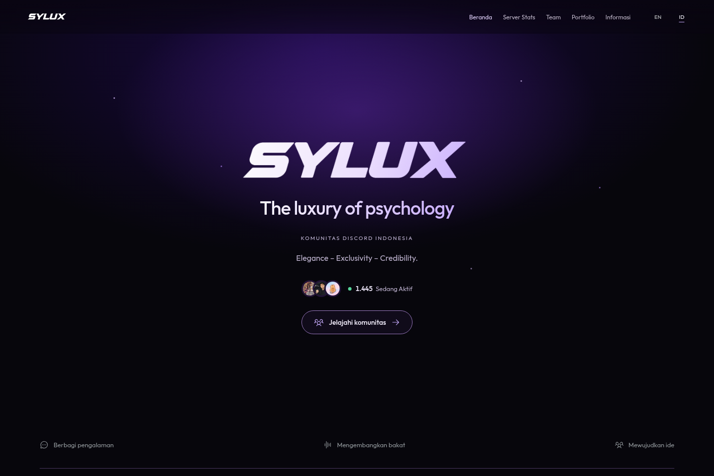

# SYLUX

The luxury of psychology.

Source website komunitas SYLUX: profil tim, dokumentasi event, statistik server, dan informasi divisi. Konten tersedia dalam Bahasa Indonesia dan Inggris.

[Website](https://syluxofficial.vercel.app/) · [Discord](https://discord.gg/sylux) · [Instagram](https://www.instagram.com/syluxcommunity_/) · [TikTok](https://www.tiktok.com/@syluxcommunity_)


[](https://syluxofficial.vercel.app/)

## Tentang proyek

Frontend memakai React, TypeScript, dan Vite. API berjalan sebagai Vercel Functions. Font Outfit disimpan lokal, ikon memakai Phosphor, dan tampilan ditulis dengan CSS tanpa framework UI.

- **Tim:** profil Discord, banner jika tersedia, pencarian, filter peran, dan urutan A–Z.
- **Server Stats:** perkiraan jumlah anggota dan pengguna aktif dari undangan publik Discord.
- **Portfolio:** dokumentasi kegiatan dalam galeri horizontal, filter kategori, dan penampil foto layar penuh.
- **Informasi:** divisi Sentinel, role levelling, dan legacy recognition.

Halaman komunitas bersifat publik. Route `/login` dan `/account` tersedia untuk autentikasi Discord opsional.

## Menjalankan lokal

Gunakan Node.js 24 LTS dan npm.

```sh
git clone https://github.com/darvinct/website-komunitasi.git
cd website-komunitasi
npm ci
cp .env.example .env.local
```

Ubah `SITE_URL` di `.env.local` menjadi `http://localhost:5173`. Isi konfigurasi Discord sesuai fitur yang ingin dijalankan.

Terminal pertama, jalankan API:

```sh
npm run dev:api
```

Terminal kedua, jalankan frontend:

```sh
npm run dev
```

Buka [localhost:5173](http://localhost:5173). Vite meneruskan request `/api` ke port `3001`.

Tanpa bot token, halaman tetap bisa dibuka, tetapi profil tim belum tersedia. Statistik server memakai endpoint undangan publik Discord dan tidak memerlukan bot token.

## Konfigurasi

Untuk lokal, gunakan `.env.local`. Untuk production, isi lewat pengaturan environment variables di Vercel.

| Variabel | Kegunaan |
| --- | --- |
| `SITE_URL` | Origin aplikasi. Lokal: `http://localhost:5173`. Production: `https://syluxofficial.vercel.app`. |
| `DISCORD_BOT_TOKEN` | Mengambil profil anggota tim dari Discord. |
| `DISCORD_GUILD_ID` | Opsional. Memakai nickname/avatar server dan memeriksa keanggotaan tim di server tersebut. |
| `VITE_DISCORD_INVITE` | Opsional. Undangan untuk tombol gabung dan sumber statistik. Default: `https://discord.gg/sylux`. |

Variabel dengan awalan `VITE_` ikut masuk ke frontend. Simpan bot token dan konfigurasi sesi sebagai variabel server. `.env.local` sudah diabaikan Git.

<details>
<summary>Konfigurasi login Discord</summary>

Tambahkan tiga variabel berikut jika ingin memakai login:

| Variabel | Kegunaan |
| --- | --- |
| `DISCORD_CLIENT_ID` | Application ID dari Discord Developer Portal. |
| `DISCORD_CLIENT_SECRET` | Client secret dari aplikasi yang sama. |
| `SESSION_SECRET` | Secret acak minimal 32 byte untuk cookie sesi. |

Daftarkan `${SITE_URL}/api/auth/callback` di bagian OAuth2 Redirects pada [Discord Developer Portal](https://discord.com/developers/applications). Untuk lokal, gunakan `http://localhost:5173/api/auth/callback`.

Login memakai scope `identify`, PKCE, dan cookie sesi HttpOnly. Login pengunjung tidak menambahkan mereka ke daftar tim.

</details>

## Mengubah konten

| Yang ingin diubah | Berkas |
| --- | --- |
| Identitas, sosial media, teks ID/EN, dan daftar event | [`src/data/site.ts`](src/data/site.ts) |
| Anggota tim, peran, divisi, dan bio | [`server/team.json`](server/team.json) |
| Divisi Sentinel dan role levelling | [`src/data/roles.ts`](src/data/roles.ts) |
| Pratinjau tautan Discord dan Open Graph | [`src/data/share.json`](src/data/share.json) |
| Token warna, font, dan gaya umum | [`src/styles.css`](src/styles.css) |
| Foto dokumentasi, maskot, dan logo | [`public/images/`](public/images/) |

Nama, username, avatar, dan banner tim diambil dari Discord jika tersedia. Peran dan bio ditentukan di `server/team.json`. Urutan peran di file tersebut menentukan urutan kelompok pada halaman; satu akun bisa masuk ke beberapa divisi. Data profil memakai cache, jadi perubahan avatar tidak selalu langsung muncul.

Untuk menambah event, tambahkan entri ke `events` di `src/data/site.ts` dan simpan fotonya di `public/images/`. Kategori filter mengikuti data event secara otomatis.

## Struktur

```text
api/              Endpoint auth, tim, dan statistik komunitas
server/           Integrasi Discord, cache, dan server API lokal
src/components/   Komponen halaman dan interaksi
src/data/         Identitas, event, role, dan teks ID/EN
src/lib/          Helper dan hook
public/           Gambar dan font lokal
docs/             Catatan teknis dan pratinjau
scripts/          Pemeriksaan dan plugin metadata berbagi
```

## Pemeriksaan dan build

```sh
npm run check
npm run build
npm run preview
```

`check` memeriksa filter anggota, validasi undangan, OAuth, sesi, statistik komunitas, dan metadata berbagi Discord. Pengujian integrasi Discord memakai respons tiruan.

`build` memeriksa TypeScript dan menghasilkan folder `dist`. `preview` menyajikan hasil build; jalankan `dev:api` juga jika ingin memakai API lokal.

## Deploy

Import repository ke Vercel dengan preset **Vite**. Perintah build dan folder output sudah diatur di [`vercel.json`](vercel.json).

Isi environment variables untuk Production, pastikan `SITE_URL` sesuai domain yang dipakai, lalu deploy. Pada repository ini, perubahan di branch `main` memicu deployment melalui integrasi GitHub dan Vercel.

## Aset

Identitas SYLUX, maskot, dan dokumentasi kegiatan berasal dari pengelola komunitas. Font [Outfit](https://github.com/Outfitio/Outfit-Fonts) memakai SIL Open Font License; salinannya ada di [`public/fonts/OFL.txt`](public/fonts/OFL.txt). Ikon [Phosphor](https://phosphoricons.com/) memakai lisensi MIT.
